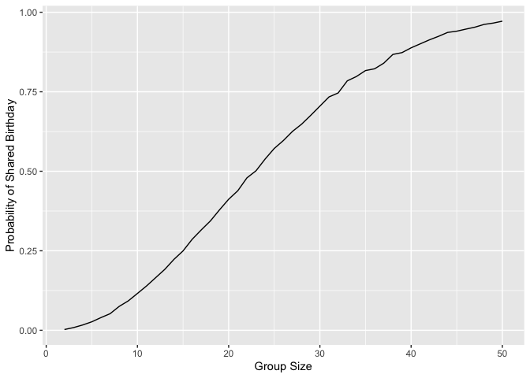
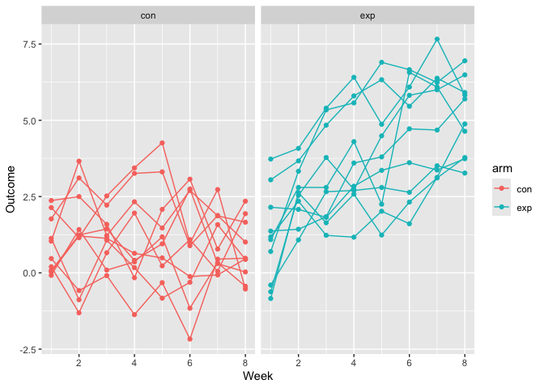

Homework 5
================
Zhiyue Liu
2026-11-17

## Problem 1

``` r
library(tidyverse)
```

    ## ── Attaching core tidyverse packages ──────────────────────── tidyverse 2.0.0 ──
    ## ✔ dplyr     1.2.1     ✔ readr     2.2.0
    ## ✔ forcats   1.0.1     ✔ stringr   1.6.0
    ## ✔ ggplot2   4.0.3     ✔ tibble    3.3.1
    ## ✔ lubridate 1.9.5     ✔ tidyr     1.3.2
    ## ✔ purrr     1.2.2     
    ## ── Conflicts ────────────────────────────────────────── tidyverse_conflicts() ──
    ## ✖ dplyr::filter() masks stats::filter()
    ## ✖ dplyr::lag()    masks stats::lag()
    ## ℹ Use the conflicted package (<http://conflicted.r-lib.org/>) to force all conflicts to become errors

``` r
set.seed(1)

birthday_match = function(n) {
  birthdays = sample(1:365, size = n, replace = TRUE)
  any(duplicated(birthdays))
}

birthday_results =
  expand_grid(
    group_size = 2:50,
    iter = 1:10000
  ) |>
  mutate(
    shared_birthday = map_lgl(group_size, birthday_match)
  ) |>
  group_by(group_size) |>
  summarize(
    probability = mean(shared_birthday)
  )

birthday_results |>
  ggplot(aes(x = group_size, y = probability)) +
  geom_line() +
  labs(
    x = "Group Size",
    y = "Probability of Shared Birthday"
  )
```

<!-- -->

The probability of sharing a birthday increases as the group size
increases. With around 23 people, the probability is about 50%. By 50
people, the probability is approximately 97%.

## Problem 2

``` r
full_df =
  tibble(
    files = list.files("data/"),
    path = str_c("data/", files)
  ) |>
mutate(data = map(path, \(x) read_csv(x, show_col_types = FALSE)))|>
  unnest(cols = data)
```

``` r
tidy_df =
  full_df |>
  mutate(
    files = str_replace(files, ".csv", ""),
    arm = str_sub(files, 1, 3)
  ) |>
  pivot_longer(
    week_1:week_8,
    names_to = "week",
    values_to = "outcome",
    names_prefix = "week_"
  ) |>
  mutate(week = as.numeric(week)) |>
  select(arm, subject_id = files, week, outcome)

tidy_df
```

    ## # A tibble: 160 × 4
    ##    arm   subject_id  week outcome
    ##    <chr> <chr>      <dbl>   <dbl>
    ##  1 con   con_01         1    0.2 
    ##  2 con   con_01         2   -1.31
    ##  3 con   con_01         3    0.66
    ##  4 con   con_01         4    1.96
    ##  5 con   con_01         5    0.23
    ##  6 con   con_01         6    1.09
    ##  7 con   con_01         7    0.05
    ##  8 con   con_01         8    1.94
    ##  9 con   con_02         1    1.13
    ## 10 con   con_02         2   -0.88
    ## # ℹ 150 more rows

``` r
tidy_df |>
  ggplot(aes(x = week, y = outcome, group = subject_id, color = arm)) +
  geom_point() +
  geom_path() +
  facet_grid(~arm) +
  labs(
    x = "Week",
    y = "Outcome"
  )
```

<!-- -->

The control group stays relatively stable over time, while the
experimental group shows an increasing trend. There is some variation
between subjects in both groups.

## Problem 3
